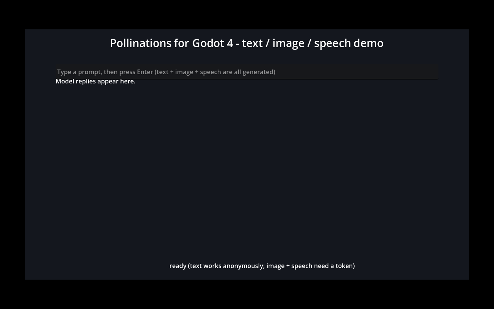

# Pollinations for Godot 4

**Add AI to your Godot game with a few nodes.** Text generation (chat), image
generation and text-to-speech, powered by the live
[Pollinations](https://pollinations.ai) model catalog — no SDK, no native
binaries, pure GDScript.



*The included example scene: one prompt → NPC reply (text model), illustration
(image model) and spoken audio (TTS model), generated live from Godot 4.7.1.*

## Nodes

| Node | What it does | Signal you use |
|---|---|---|
| `PollinationsText` | Chat completion (OpenAI-compatible), any model from the live text list | `completed(text)` |
| `PollinationsImage` | Text-to-image, returns a ready-to-use `Texture2D` | `completed(texture)` |
| `PollinationsSpeech` | Text-to-speech, returns an `AudioStreamWAV` (and autoplays it) | `completed(stream)` |
| `PollinationsAuth` | Bring-your-own-Pollen device-flow login for players | `device_flow_authorized(token)` |

All model ids come from the **live model lists** (`/text/models`,
`/image/models`, `/audio/models` on `gen.pollinations.ai`), so new models work
without an add-on update.

## Install

1. Clone or download this repository.
2. Copy the `addons/pollinations` folder into your project.
3. Enable **Project → Project Settings → Plugins → Pollinations AI**.
4. Drop the nodes into any scene (they show up in the *Create New Node*
   dialog under their class names).

Requires Godot 4.x (verified on **4.7.1.stable**). No other dependencies.

## Quick start (GDScript)

```gdscript
# Text - works without any account (anonymous tier)
var ai := PollinationsText.new()
add_child(ai)
ai.completed.connect(func(text: String): print(text))
ai.generate("Write a haiku about boats")

# Image - needs a token (see Auth below)
var img := PollinationsImage.new()
add_child(img)
img.completed.connect(func(tex: Texture2D): $Sprite2D.texture = tex)
img.generate("a red cube on white background")

# Speech - needs a token; plays out loud and hands you the stream
var speech := PollinationsSpeech.new()
add_child(speech)
speech.speak("Welcome, adventurer!")
```

## Auth: dev key vs. players paying with their own Pollen

- **Development:** export `POLLINATIONS_API_KEY` with an API key from
  [enter.pollinations.ai/keys](https://enter.pollinations.ai/keys) before
  launching the editor/game, or set `auth_token` on a node.
- **Players (BYOP device flow):** add a `PollinationsAuth` node next to the
  generation nodes and start the flow when the player clicks "Connect":

```gdscript
var auth: PollinationsAuth = $PollinationsAuth
auth.device_flow_started.connect(func(user_code: String, url: String):
    print("Go to ", url, " and enter code: ", user_code))
auth.device_flow_authorized.connect(func(_t): print("Connected!"))
auth.start_device_flow()
```

The player approves the request on enter.pollinations.ai/device and pays
generation costs with their **own Pollen**. The returned token is kept in
memory and (optionally) in `user://` project settings; it is **never** bundled
with your game. Text generation also works fully anonymously, so you can ship
a demo with zero setup.

## Demo / example scene

Open this repository as a project and run `examples/example_scene.tscn`
(the main scene). Type a prompt and press Enter: the NPC replies in one
sentence, an illustration appears on the right, and the reply is spoken by a
TTS model. Screenshot above was captured from this exact scene running in
Godot 4.7.1.

## Verification (headless, reproducible)

The repo ships with a test script that runs in the real engine:

```sh
# offline compile/instantiation checks + one live anonymous text call
godot4 --headless -s tests/verify_addon.gd

# full pass incl. live image + speech (token kept OUT of the repo)
POLLINATIONS_API_KEY=sk_... godot4 --headless -s tests/verify_addon.gd
```

Latest run (Godot 4.7.1.stable, headless, this repo):

```
=== Pollinations Godot add-on verification ===
  ok compile: res://addons/pollinations/pollinations.gd
  ok compile: res://addons/pollinations/pollinations_api.gd
  ok compile: res://addons/pollinations/pollinations_auth.gd
  ok compile: res://addons/pollinations/nodes/pollinations_text.gd
  ok compile: res://addons/pollinations/nodes/pollinations_image.gd
  ok compile: res://addons/pollinations/nodes/pollinations_speech.gd
  ok compile: res://examples/example_scene.gd
  ok plugin.cfg (script=pollinations.gd)
  ok instantiate: pollinations_text.gd
  ok instantiate: pollinations_image.gd
  ok instantiate: pollinations_speech.gd
  ok instantiate: pollinations_auth.gd
  ok wav parser: 0.2 s stream, 24000 Hz, 9600 bytes
  ok live text: 9 chars -> POLLEN OK
  ok live image: 1024x1024 texture
  ok live speech: 3.2 s of audio, 24000 Hz
=== verification finished: PASS ===
```

The example scene itself was also run headless
(`godot4 --headless --path . --quit-after 30`, exit 0, zero script errors).

## Files

```
addons/pollinations/
├── plugin.cfg                  # editor plugin metadata
├── pollinations.gd             # EditorPlugin entry point
├── pollinations_api.gd         # endpoints, model lists, model fetch helper
├── pollinations_auth.gd        # PollinationsAuth: device flow + token store
└── nodes/
    ├── pollinations_text.gd    # PollinationsText
    ├── pollinations_image.gd   # PollinationsImage
    └── pollinations_speech.gd  # PollinationsSpeech (incl. WAV parser)
examples/
├── example_scene.tscn          # runnable demo (main scene)
└── example_scene.gd
tests/
└── verify_addon.gd             # headless verification (see above)
```

## Notes

- Image and audio models require a token (401 without one); text works
  anonymously. The add-on surfaces this as a clear `failed` signal.
- Generation results are cached to `user://pollinations/` (PNG / WAV) so you
  can inspect what was produced.
- The HTTP endpoints used are the documented Pollinations ones:
  `POST /v1/chat/completions`, `POST /v1/images/generations`,
  `POST /v1/audio/speech`, `GET /{text,image,audio}/models`, plus
  `POST /api/device/code` + `POST /api/device/token` on
  `enter.pollinations.ai` for the device flow.

## License

MIT
